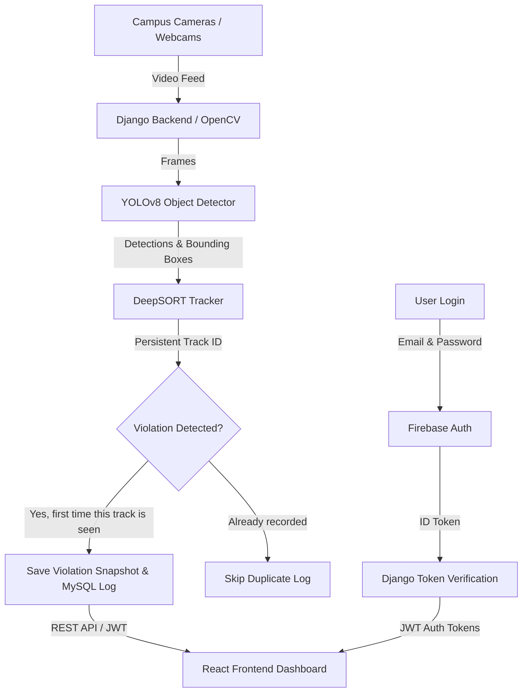

# GateWatch Uni-Guard 🎓🛡️
### Real-Time AI-Powered Student Uniform Compliance Monitoring & Tracking System

[](https://www.djangoproject.com/)
[](https://react.dev/)
[](https://github.com/ultralytics/ultralytics)
[](https://github.com/levan92/deep_sort_realtime)
[](https://firebase.google.com/)
[](https://www.mysql.com/)

**GateWatch Uni-Guard** is an automated campus security and compliance system designed to monitor student uniform compliance in real time through gate and surveillance cameras. By combining custom-trained **YOLOv8** object detection with **DeepSORT** multi-object tracking, the system tracks individuals, detects dress code violations, captures snapshot evidence, and prevents duplicate violation logs.

---

## 📌 Table of Contents

- [Key Features](#-key-features)
- [System Architecture](#%EF%B8%8F-system-architecture)
- [Tech Stack](#-tech-stack)
- [Project Structure](#-project-structure)
- [Getting Started](#-getting-started)
  - [Prerequisites](#prerequisites)
  - [Backend Setup](#1-backend-setup)
  - [Frontend Setup](#2-frontend-setup)
- [Environment Variables](#-environment-variables)
- [Roles & Permissions](#-roles--permissions)
- [Detection & Tracking Pipeline](#-detection--tracking-pipeline)
- [License](#-license)

---

## ✨ Key Features

- **Real-Time Uniform Detection**: Custom-trained YOLOv8 model (`best.pt`) detects compliant and non-compliant attire instantly across live camera feeds.
- **DeepSORT Multi-Object Tracking**: Assigns persistent track IDs to individuals across frames to eliminate duplicate violation entries for the same person.
- **Camera Stream Management**: Security personnel can manage multiple RTSP/IP or web cameras, start/stop monitoring, and view active tracks.
- **Automated Evidence Logging**: Captures timestamped violation snapshots and stores compliance logs with high-resolution image references.
- **Role-Based Access Control (RBAC)**:
  - **Admin**: Full system management, compliance analytics, violation reviews, user management.
  - **Security Personnel**: Live camera surveillance, real-time alerts, incident tracking.
- **Two-Tier Authentication**: Client-side Firebase Authentication paired with backend Django REST Framework JWT verification.
- **Analytics & Reporting**: Generates summary statistics, violation trends, and exportable logs.

---

## 🏗️ System Architecture



---

## 🧰 Tech Stack

| Layer | Technology |
|---|---|
| Backend | Django 5.2, Django REST Framework |
| Frontend | React 18, TypeScript |
| Computer Vision | YOLOv8 (Ultralytics), OpenCV |
| Tracking | DeepSORT (`deep_sort_realtime`) |
| Authentication | Firebase Auth + JWT |
| Database | MySQL |

---

## 📁 Project Structure

```text
uniform-detection/
├── backend/     # Django project, REST API, detection + tracking code, best.pt
├── frontend/    # React + TypeScript dashboard
└── README.md
```

> Adjust the folder names above to match your repository.

---

## 🚀 Getting Started

### Prerequisites

- Python 3.10+
- Node.js 18+
- MySQL 8+
- A Firebase project (Email/Password sign-in enabled)
- A webcam or RTSP/IP camera for testing

### 1. Backend Setup

```bash
cd backend
python -m venv venv
source venv/bin/activate        # Windows: venv\Scripts\activate
pip install -r requirements.txt
python manage.py migrate
python manage.py runserver
```

### 2. Frontend Setup

```bash
cd frontend
npm install
npm run dev
```

---

## 🔐 Environment Variables

Create a `.env` file in the backend (and frontend) folder. Example:

```env
# Backend
SECRET_KEY=your-django-secret-key
DEBUG=True
DB_NAME=gatewatch
DB_USER=root
DB_PASSWORD=your-password
DB_HOST=localhost
DB_PORT=3306
FIREBASE_CREDENTIALS=path/to/serviceAccountKey.json

# Frontend
VITE_API_URL=http://localhost:8000/api
VITE_FIREBASE_API_KEY=your-firebase-api-key
VITE_FIREBASE_AUTH_DOMAIN=your-project.firebaseapp.com
VITE_FIREBASE_PROJECT_ID=your-project-id
```

> Never commit real keys or `serviceAccountKey.json` to GitHub.

---

## 👥 Roles & Permissions

| Role | Access |
|---|---|
| **Admin** | System management, compliance analytics, violation reviews, user management |
| **Security Personnel** | Live camera surveillance, real-time alerts, incident tracking |

---

## 🔍 Detection & Tracking Pipeline

1. **Capture**: OpenCV reads frames from the configured camera stream.
2. **Detect**: The custom YOLOv8 model (`best.pt`) finds people and classifies their attire as compliant or non-compliant.
3. **Track**: DeepSORT assigns each person a persistent track ID across frames.
4. **Log**: The first time a tracked person is flagged, a snapshot is saved and a record is written to MySQL. Later frames with the same track ID are skipped to avoid duplicates.
5. **Display**: The React dashboard receives violations through the REST API, secured with JWT.

---

## 📄 License

Add your license here (for example, MIT) and include a `LICENSE` file in the repository.
